# Site map

Every page and every section, top to bottom, with what it looks like and where it lives. Use it to tell Claude exactly what to change.

**How to name a section:** `Page › Section`, using the small red label you see above the heading on the site, e.g. `Home › Clinical Testing` or `Operating Room › The Problem`.

**Where things live:**

- Words, links, image and video paths → the **content file** (`content/...json`). Most changes only touch this.
- Image and video files → `public/assets/<page>/`
- Layout, colors, animation → the **code** file (`src/components/...`)

Screenshots were taken on 19 Oct 2026. If the site has changed since, ask Claude to refresh them (see `docs/EDITING-WITH-CLAUDE-CODE.md`).

## Contents

- [On every page: menu bar and footer](#on-every-page)
- [Home](#home)
- [About](#about)
- [Technology](#technology)
- [Clinical Evidence](#clinical-evidence)
- [Solutions pages](#solutions-pages) (Operating Room, Anesthesiology, Critical Care, Sleep Medicine, Home Monitoring)
- [Product](#product)
- [News](#news)
- [FAQ](#faq)
- [Partner With Us](#partner-with-us)
- [Contact](#contact)
- [Legal pages](#legal-pages)

## On every page

### Menu bar

- **Content:** `content/site.json → nav` (logo, items: label + href, mobileMenu)
- **Code:** `src/components/layout/Nav.tsx`

### Footer

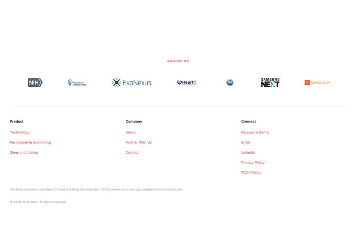

- **Content:** `content/site.json → footer` (backedBy logos, linkGroups, disclaimer, copyright)
- **Code:** `src/components/layout/Footer.tsx`

### Contact form (Partner and Contact pages)

- **Content:** `content/site.json → contactForm` (labels, placeholders, role options, button, success message)
- **Code:** `src/components/shared/ContactForm.tsx`. Submissions go to Netlify Forms; don't rename the form fields.

### Error and 404 pages

- **Content:** `content/site.json → notFound`, `error`

## Home

`/` · content: `content/home.json` · route: `src/routes/index.tsx`

### 1. Home › Hero

_top banner with background video_

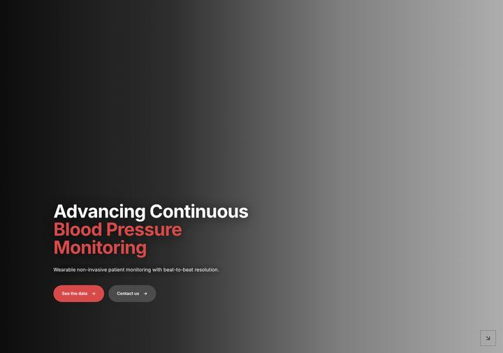

- **Content:** `content/home.json → hero`: title, titleAccent (red part), body, button + href, secondaryButton + secondaryHref, videos
- **Code:** `src/components/home/Hero.tsx` → Hero

### 2. Home › Problem & Solution

_cuff vs. VeriTrack comparison_

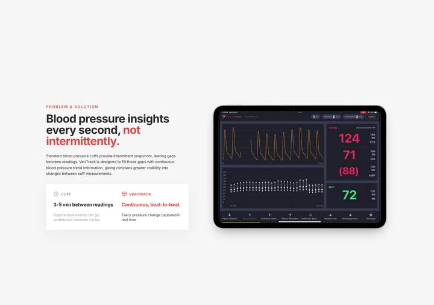

- **Content:** `content/home.json → problem`: eyebrow, title, titleAccent, body, comparison (cuffLabel, venaLabel, rows), video, poster
- **Code:** `src/components/home/HomeSections.tsx` → HomeProblem

### 3. Home › The Solution

_product overview with 3 points_

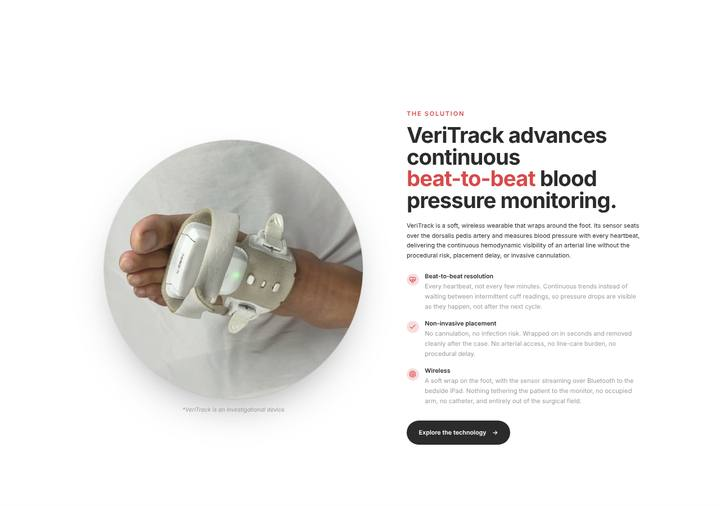

- **Content:** `content/home.json → overview`: eyebrow, title, titleAccent, titleTail, body, points (icon, title, body), video, footnote, button + href
- **Code:** `src/components/home/HomeSections.tsx` → HomeOverview

### 4. Home › Clinical Testing

_OR chart + 5 count-up stats_

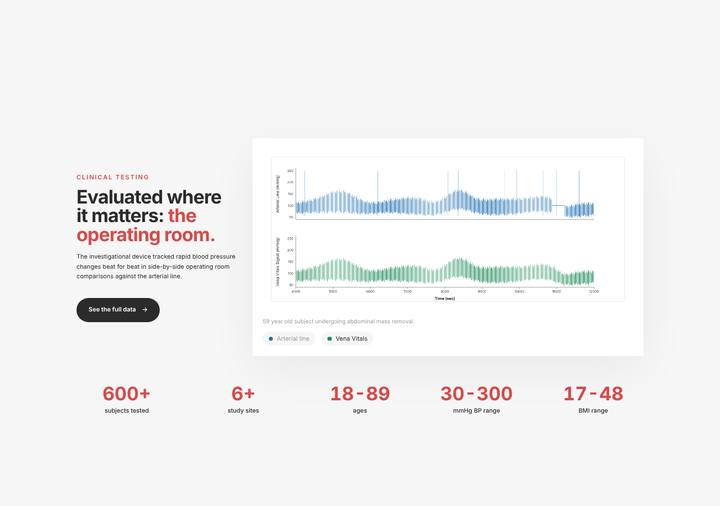

- **Content:** `content/home.json → evidence`: eyebrow, title, titleAccent, body, button + href, chart labels, stats (from, to, prefix, suffix, label)
- **Code:** `src/components/home/HomeSections.tsx` → HomeEvidenceStrip

### 5. Home › Areas of Investigation

_two cards (OR, sleep/home)_

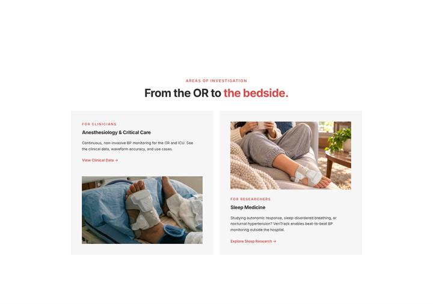

- **Content:** `content/home.json → audiences`: eyebrow, title, titleAccent, cards (eyebrow, title, body, button, href, image, alt)
- **Code:** `src/components/home/HomeSections.tsx` → HomeAudienceCards

### 6. Home › Collaborate With Us

_closing call to action_

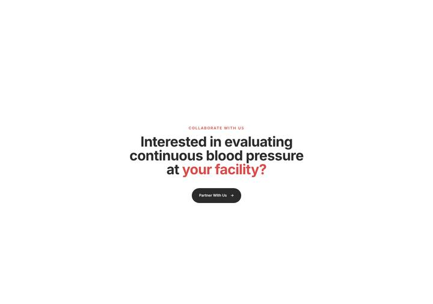

- **Content:** `content/home.json → finalCta`: eyebrow, title, titleAccent, button + href
- **Code:** `src/components/home/HomeSections.tsx` → HomeFinalCta

## About

`/about` · content: `content/about.json` · route: `src/routes/about.tsx`

### 1. About › About Us

_top banner_

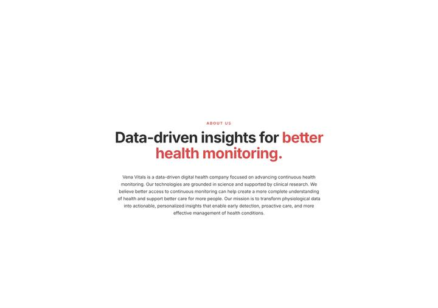

- **Content:** `content/about.json → hero`: eyebrow, title, titleAccent, body
- **Code:** `src/components/about/About.tsx`

### 2. About › Core Team

_team headshots_

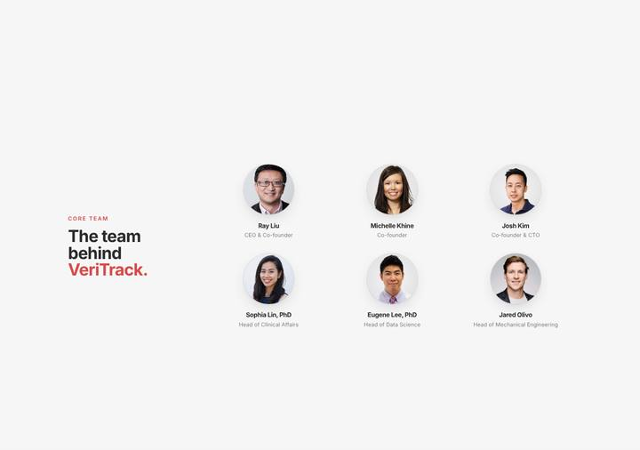

- **Content:** `content/about.json → team`: eyebrow, title, titleAccent, members (name, role, image, alt, title, href, bio)
- **Code:** `src/components/about/About.tsx`

### 3. About › Inside the Company

_photo strip, **hidden right now** at the team's request_

_(hidden, no screenshot)_

- **Content:** `content/about.json → moments`: eyebrow, title, titleAccent, photos (image, alt, caption)
- **Code:** `src/components/about/About.tsx` (commented out)

### 4. About › Careers

_closing call to action_

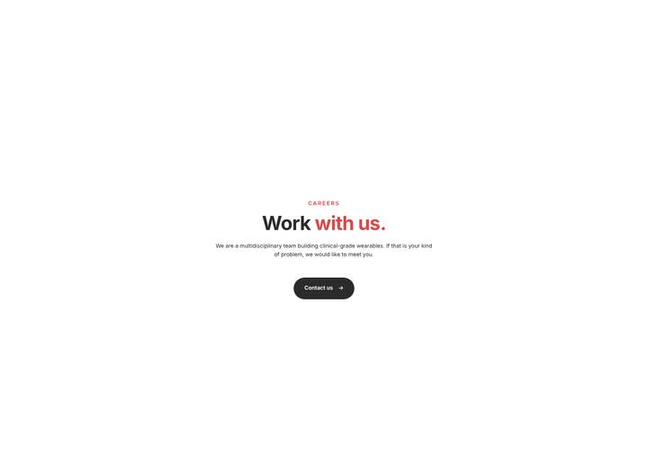

- **Content:** `content/about.json → careers`: eyebrow, title, titleAccent, body, button + href
- **Code:** `src/components/about/About.tsx`

## Technology

`/technology` · content: `content/technology.json` · route: `src/routes/technology.tsx`

### 1. Technology › The Science

_top banner with video_

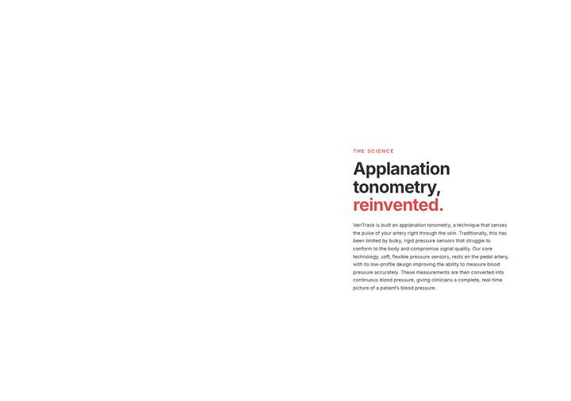

- **Content:** `content/technology.json → hero`: video, alt, eyebrow, title, titleAccent, body
- **Code:** `src/components/technology/Technology.tsx`

### 2. Technology › Signal Journey

_4-step sensor-to-screen walkthrough, **hidden right now**_

_(hidden, no screenshot)_

- **Content:** `content/technology.json → signalJourney`: eyebrow, title, titleAccent, body, steps (step, title, body, video)
- **Code:** `src/components/technology/SignalJourney.tsx` (commented out in Technology.tsx)

### 3. Technology › Sensing Mechanism

_video + 7 advantages_

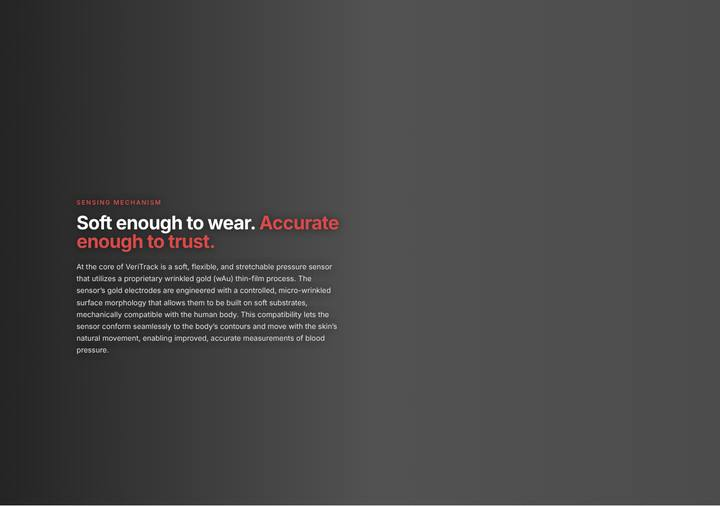

- **Content:** `content/technology.json → sensingMechanism`: video, eyebrow, title, titleAccent, body, advantages (icon, title, points)
- **Code:** `src/components/technology/Technology.tsx`

## Clinical Evidence

`/clinical-evidence` · content: `content/clinical-evidence.json` · route: `src/routes/clinical-evidence.tsx`

### 1. Clinical Evidence › Clinical Validation

_top banner with 3 stats_

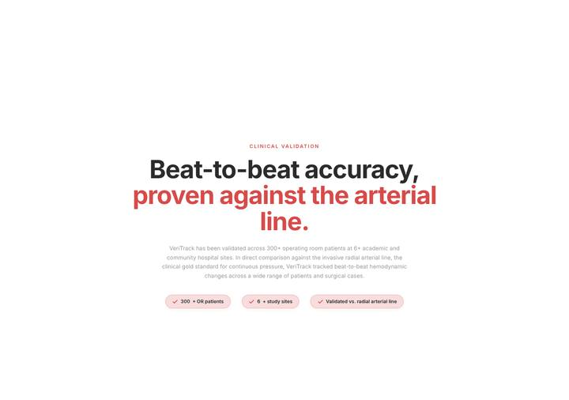

- **Content:** `content/clinical-evidence.json → hero`: eyebrow, title, titleAccent, body, stats
- **Code:** `src/components/clinical-evidence/Evidence.tsx` → HeroStat

### 2. Clinical Evidence › Validation Program

_study site logos_

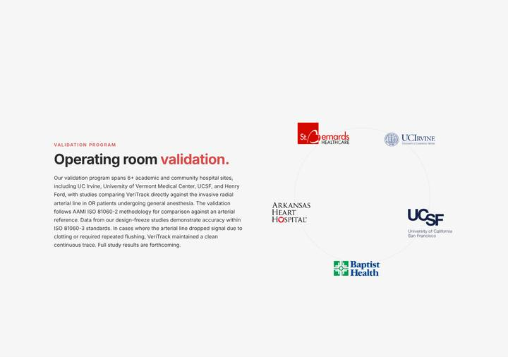

- **Content:** `content/clinical-evidence.json → validation`: eyebrow, title, titleAccent, body, sites (image, alt)
- **Code:** `src/components/clinical-evidence/Evidence.tsx`

### 3. Clinical Evidence › Research Pipeline

_5 study cards_

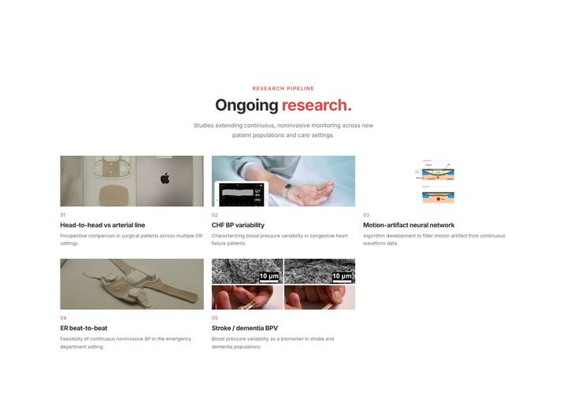

- **Content:** `content/clinical-evidence.json → research`: eyebrow, title, titleAccent, body, studies (title, body, image, alt)
- **Code:** `src/components/clinical-evidence/Evidence.tsx` → ResearchPipeline

### 4. Clinical Evidence › Standards

_methodology definitions_

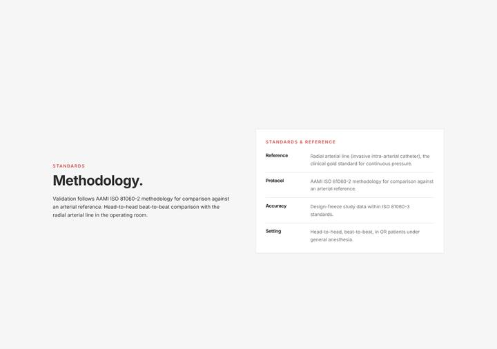

- **Content:** `content/clinical-evidence.json → methodology`: eyebrow, title, body, cardEyebrow, rows (term, definition)
- **Code:** `src/components/clinical-evidence/Evidence.tsx`

## Solutions pages

All five use one shared template, `src/components/solutions/SolutionDetail.tsx`. **A section only shows up if its fields are in that page's content file**, so deleting a section's fields hides it on that one page, and adding them shows it.

Section order is always: hero → figures → gallery → cards → fit → collaborators → windows → cta (skipping the ones that aren't there).

Text shared by all five (testimonial quotes, slideshow labels, the default CTA label) is in `content/solutions/shared.json`.

### Operating Room

`/solutions/operating-room` · content: `content/solutions/operating-room.json`

#### 1. Operating Room › Hero

_top banner_

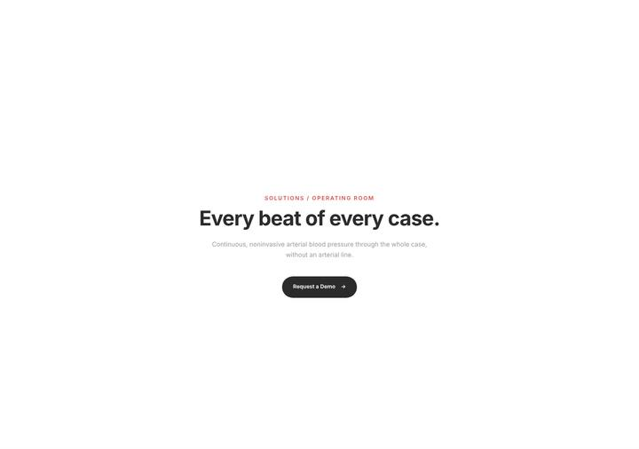

- **Content fields:** eyebrow, title, intro, button

#### 2. Operating Room › The Problem

_3 numbered cards_

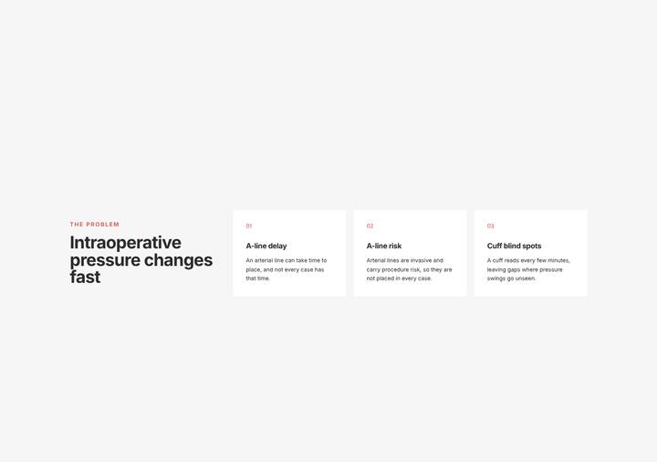

- **Content fields:** sectionEyebrow, sectionTitle, cards (title, body)

#### 3. Operating Room › How VeriTrack Fits

_placement explanation_

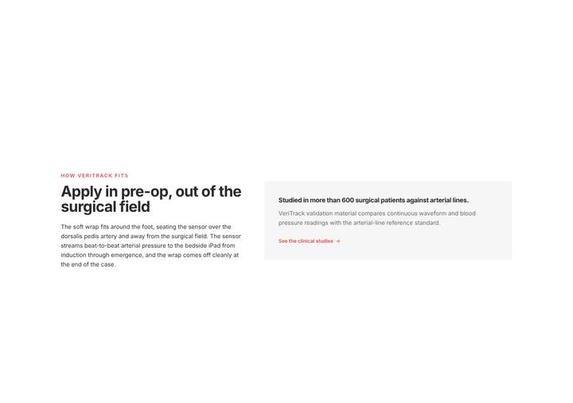

- **Content fields:** fitEyebrow, fitTitle, fitBody

#### 4. Operating Room › In the Operating Room

_3 videos + note_

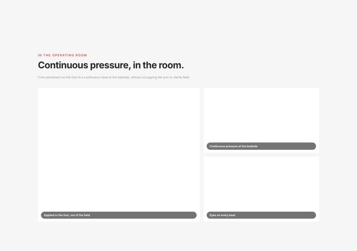

- **Content fields:** windowsEyebrow, windowsTitle, windowsBody, windows (src, label, feature), noteTitle, noteBody

#### 5. Operating Room › Get Started

_closing call to action_

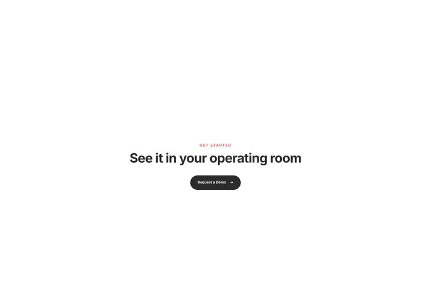

- **Content fields:** cta

### Anesthesiology

`/solutions/anesthesiology` · content: `content/solutions/anesthesiology.json`

#### 1. Anesthesiology › Hero

_top banner_

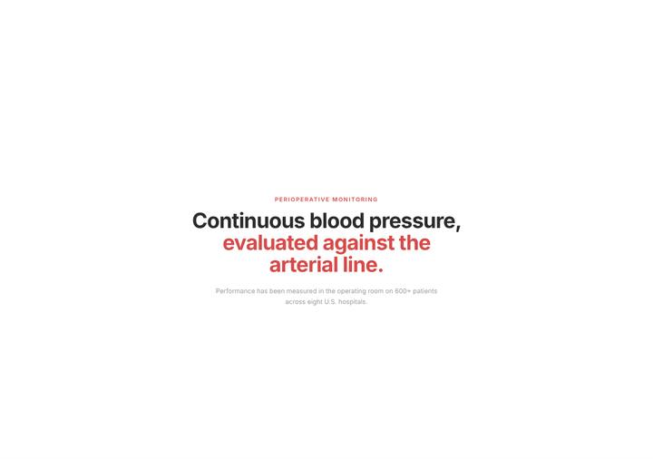

- **Content fields:** eyebrow, title, titleAccent, intro, showHeroButton

#### 2. Anesthesiology › Operating Room Data

_study figure slideshow_

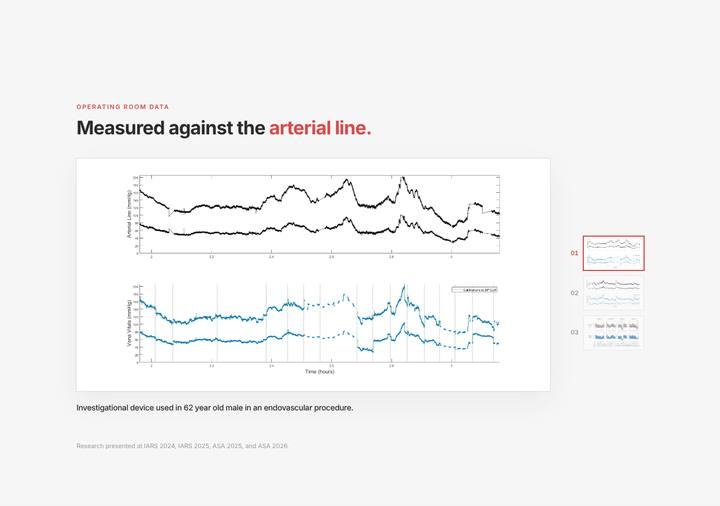

- **Content fields:** figures (eyebrow, title, titleAccent, footnote, slides: src, alt, caption)

#### 3. Anesthesiology › Perspectives

_clinician quote_

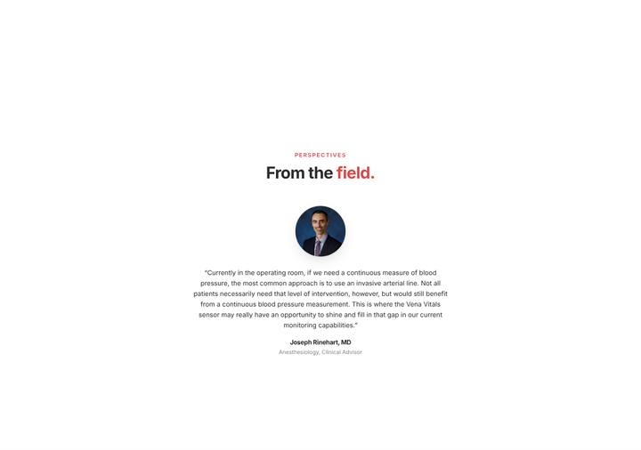

- **Content fields:** collaborators (names) + quotes in `solutions/shared.json → testimonials`

### Critical Care

`/solutions/critical-care` · content: `content/solutions/critical-care.json`

#### 1. Critical Care › Hero

_top banner_

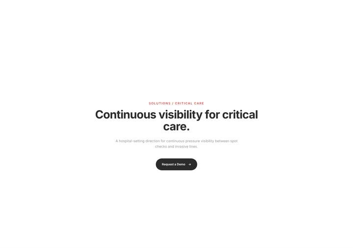

- **Content fields:** eyebrow, title, intro, button

#### 2. Critical Care › The Need

_3 numbered cards_

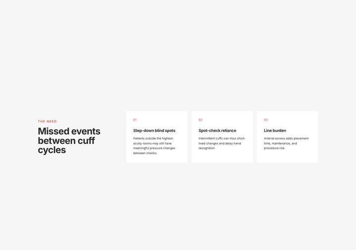

- **Content fields:** sectionEyebrow, sectionTitle, cards

#### 3. Critical Care › How VeriTrack Fits

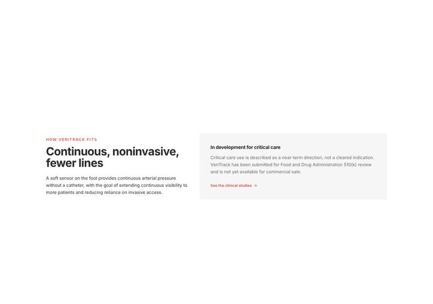

- **Content fields:** fitEyebrow, fitTitle, fitBody

#### 4. Critical Care › In Critical Care

_3 video windows + note_

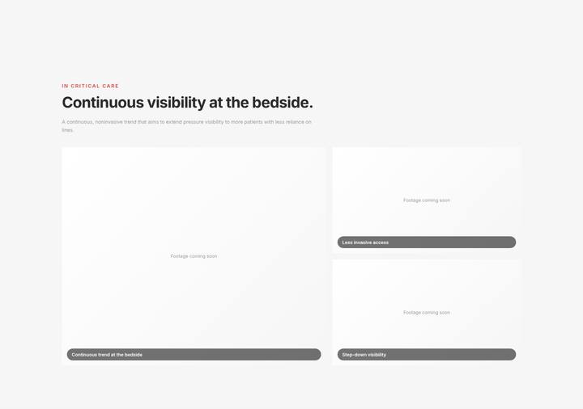

- **Content fields:** windowsEyebrow, windowsTitle, windowsBody, windows, noteTitle, noteBody

#### 5. Critical Care › Get Started

_closing call to action_

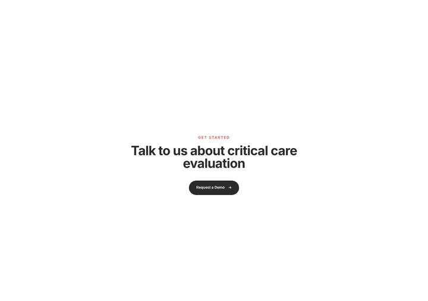

- **Content fields:** cta

### Sleep Medicine

`/solutions/sleep-medicine` · content: `content/solutions/sleep-medicine.json`

#### 1. Sleep Medicine › Hero

_top banner with 3 cards_

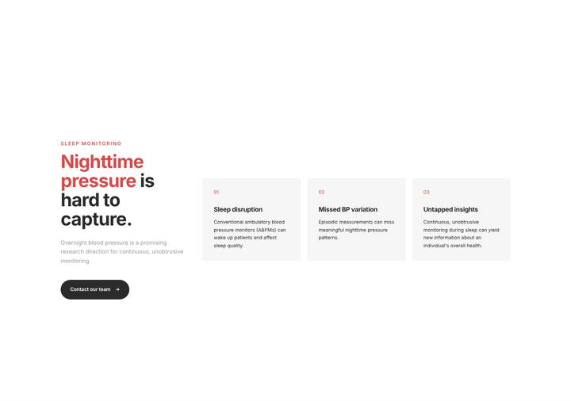

- **Content fields:** eyebrow, titleLead (red part), title, intro, heroCards (title, body)

#### 2. Sleep Medicine › Sleep Data

_2 study figures_

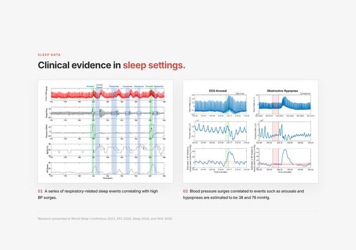

- **Content fields:** gallery (eyebrow, title, titleAccent, footnote, slides)

### Home Monitoring

`/solutions/home-monitoring` · content: `content/solutions/home-monitoring.json`

#### 1. Home Monitoring › Hero

_top banner_

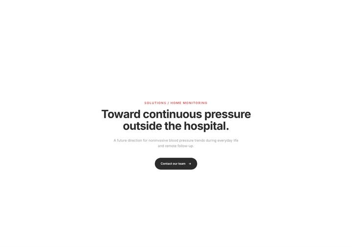

- **Content fields:** eyebrow, title, intro, button

#### 2. Home Monitoring › Future Use Case

_3 numbered cards_

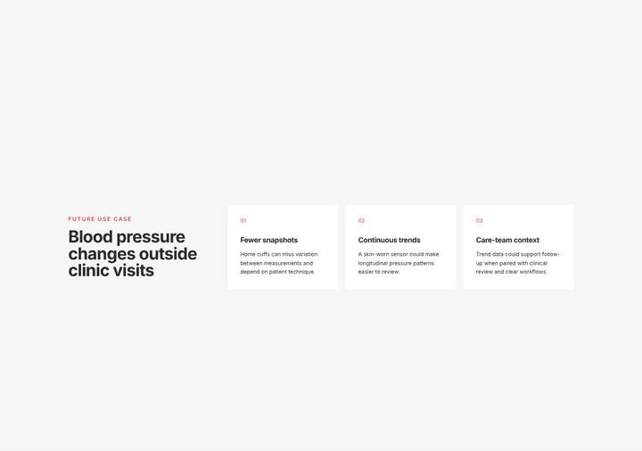

- **Content fields:** sectionEyebrow, sectionTitle, cards

#### 3. Home Monitoring › Important Note

_not-a-commercial-product note_

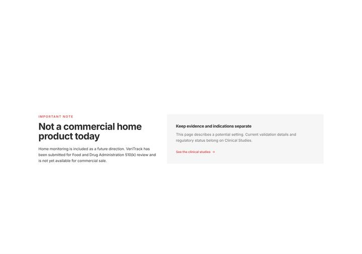

- **Content fields:** fitEyebrow, fitTitle, fitBody

#### 4. Home Monitoring › Outside the Hospital

_3 video windows + note_

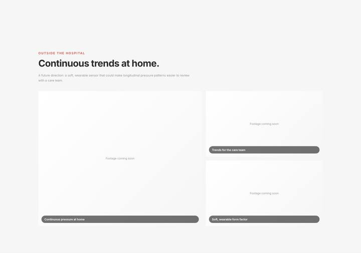

- **Content fields:** windowsEyebrow, windowsTitle, windowsBody, windows, noteTitle, noteBody

#### 5. Home Monitoring › Get Started

_closing call to action_

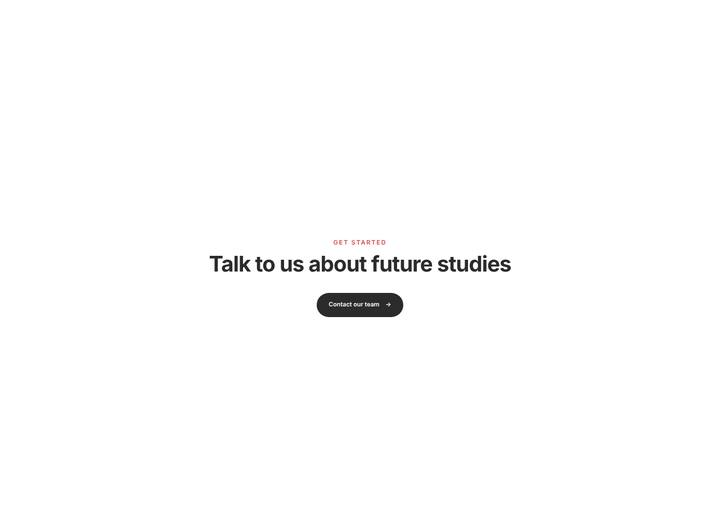

- **Content fields:** cta

## Product

`/product` · content: `content/product.json` · code: `src/components/product/Product.tsx`

### 1. Product › Whole page

_hero, 3 feature blocks, closing CTA_

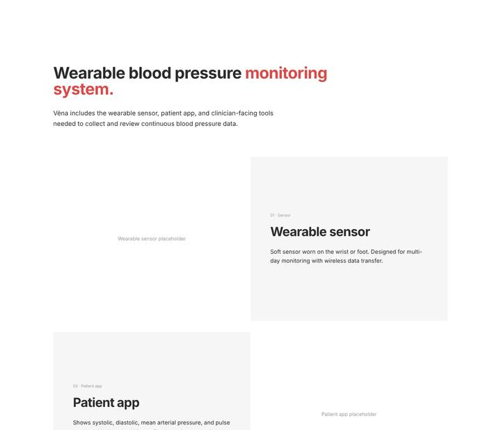

- **Content:** hero, features (items: eyebrow, title, body), finalCta

## News

`/news` · content: `content/news.json` · code: `src/components/news/News.tsx`

### 1. News › Newsroom

_top banner_

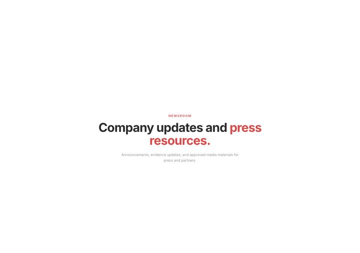

- **Content:** hero

### 2. News › Latest

_3 news posts_

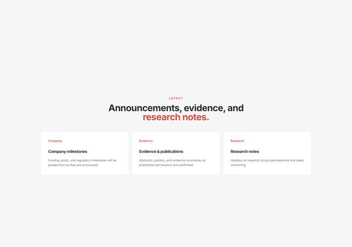

- **Content:** latest (posts: label, title, body)

### 3. News › Press Kit

_3 downloadable items_

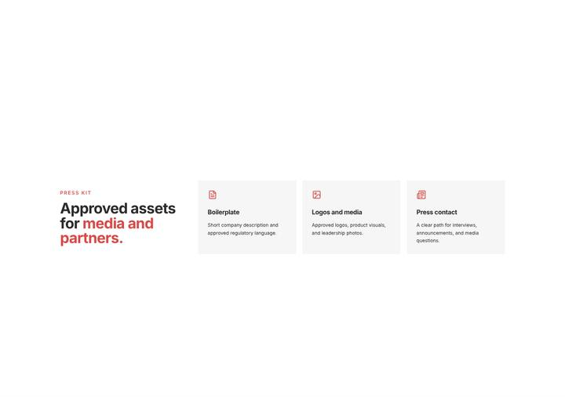

- **Content:** pressKit (items: icon, title, body)

### 4. News › Press Contact

_email call to action_

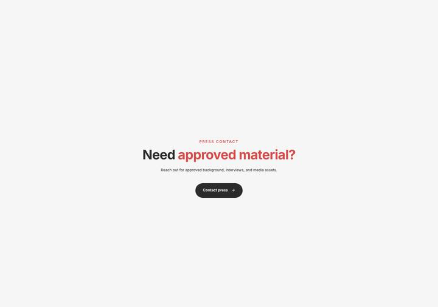

- **Content:** pressContact

## FAQ

`/faq` · content: `content/faq.json` · code: `src/components/faq/FAQ.tsx`

### 1. FAQ › Whole page

_heading + question list_

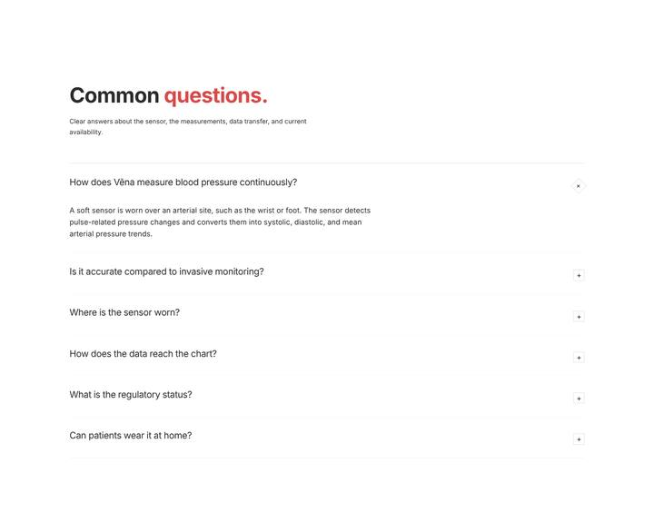

- **Content:** hero, questions (question, answer)

## Partner With Us

`/partner-with-us` · content: `content/partner.json` · code: `src/components/partner/Partner.tsx`

### 1. Partner With Us › Whole page

_banner, ways to work together, contact form_

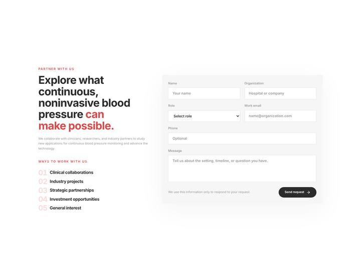

- **Content:** hero, waysToWork (items); form text in `site.json → contactForm`

## Contact

`/contact` · content: `content/contact.json` · code: `src/components/contact/Contact.tsx`

### 1. Contact › Whole page

_intro, 3 points, contact form_

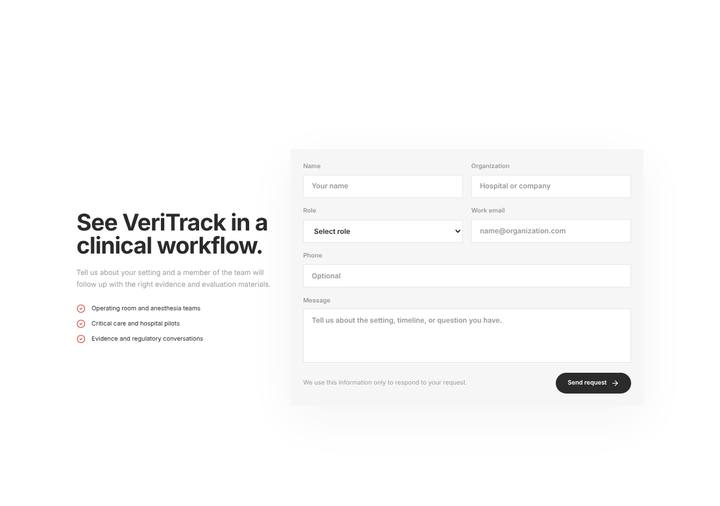

- **Content:** hero (title, body, points); form text in `site.json → contactForm`

## Legal pages

| Page           | URL               | Content                                                                           |
| -------------- | ----------------- | --------------------------------------------------------------------------------- |
| Privacy Policy | `/privacy-policy` | `content/legal/privacy-policy.json` (title, date, body paragraphs/headings/lists) |
| FCOI Policy    | `/fcoi-policy`    | `content/legal/fcoi-policy.json`                                                  |

Both use `src/components/layout/LegalPage.tsx`. Legal text changes should come from whoever owns the policy, word for word.
